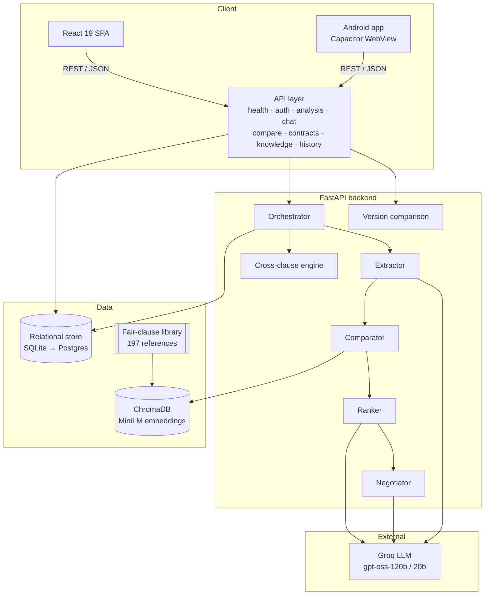

# 🛡️ ClauseGuard

**Understand any contract before you sign it.**

ClauseGuard is an AI contract-risk platform. Paste a contract or upload a PDF, and a
multi-agent pipeline extracts every clause, compares it against a curated library of
**197 fair-industry references via RAG**, scores the risk, quantifies the financial
exposure in ₹, and drafts negotiation counter-clauses with a success estimate.

Built to make consumer contracts legible — rentals, gyms, SaaS, freelance work and
employment offers, not just enterprise M&A.

<p>
  
  
  
  
  
  
  
  
  
</p>

---

## 📸 At a glance

| Dashboard | Analytics | Contract workspace |
|---|---|---|
| Risk mix, activity trend, recent contracts | Severity donut, category bars, per-contract risk, rankings | Clause explorer, review list, cross-clause links, grounded chat, PDF export |

Run the app locally (`python scripts/seed_demo.py` first) to explore a fully populated workspace.

---

## ✨ What it does

| Capability | Detail |
|---|---|
| **Multi-agent pipeline** | Extractor → Comparator (RAG vs 197 fair clauses) → Ranker (risk + ₹ impact) → Negotiator (counter-clauses + success %) |
| **Clause intelligence** | 🔴🟡🟢 severity, plain-English explanation, 0–100 risk score, similarity to the fair standard, confidence |
| **Financial exposure** | Per-clause ₹ impact plus a document-level exposure total |
| **Negotiation pack** | Rewritten fair clause, talking points, success probability and the reasoning behind it |
| **Grounded RAG chat** | Ask anything about your documents; answers cite the exact retrieved clauses and refuse when there is no evidence |
| **Key dates & reminders** | Dates written in the contract, a per-date lead time, and a cross-contract reminder feed |
| **Signing checklist** | Steps derived from the analysis itself, with progress you can tick off |
| **Saved sections** | Bookmark the clauses you want to come back to, and filter to them |
| **PDF report** | The full analysis plus key dates and the checklist, as a branded PDF |
| **Installable app** | Web app manifest, offline shell, an update prompt that never interrupts you |
| **Four languages** | English, हिन्दी, தமிழ், తెలుగు — with locale-aware dates and numbers |
| **App lock** | Optional fingerprint / face / device-PIN unlock, checked on the device itself |
| **Version drift** | Compare two versions and see which terms got better or worse, clause by clause |
| **Multi-contract compare** | Side-by-side risk matrix across documents, per category, with the fairest pick |
| **Analytics dashboard** | Severity mix, clause-category distribution, activity trends, per-contract risk stacks |
| **PDF report export** | One-click branded report: summary, clause table, key findings |
| **Uploads** | PDF / TXT / Markdown / DOCX with text extraction |
| **Accounts & quotas** | JWT + bcrypt auth, owner-scoped history, per-IP guest quota, premium tier limits |
| **Android app** | The same React app packaged with Capacitor (signed AAB/APK build) |

Seven clause categories: **Payment · Auto-Renewal · Liability · Data Privacy · Dispute · Warranty · Other**.

---

## 🏗 Architecture



> Full design, schema and agent prompts: [`docs/ARCHITECTURE.md`](docs/ARCHITECTURE.md).

### Tech stack

| Layer | Choice |
|---|---|
| Frontend | React 19, TypeScript, React Router, Recharts, lucide-react (CRA) |
| PWA | Web app manifest + service worker (offline shell, install prompt, update banner) |
| Languages | Own i18n layer — English, हिन्दी, தமிழ், తెలుగు (locale-aware dates and numbers) |
| App lock | Optional device-local WebAuthn lock (fingerprint / face / device PIN) |
| Security | Explicit CORS allowlist, generic error responses, auth required in production |
| Mobile | Capacitor 8 (Android, signed AAB) |
| API | FastAPI, Pydantic v2, Uvicorn |
| Agents / LLM | Groq (`openai/gpt-oss-120b` primary, `gpt-oss-20b` fast) |
| Retrieval | ChromaDB + `all-MiniLM-L6-v2` ONNX embeddings (cosine) |
| Persistence | SQLAlchemy 2 (SQLite dev, Postgres prod) |
| Reporting | jsPDF + autotable (lazy-loaded, client-side) |
| Ops | Docker, Render blueprint, GitHub Actions CI |

---

## 📊 Measured results

Reproducible evaluation harness (`backend/app/eval/`) over a 29-case labelled set:

| Metric | Value |
|---|---|
| Clause classification — micro-F1 | **0.714** |
| Precision | 0.741 |
| Recall | 0.690 |
| Test suite (backend) | 76 passing, LLM calls stubbed |
| Frontend checks | typecheck + production build + 21 tests (routing, PWA, translations) in CI |
| Translation audit | 566 keys checked against all four catalogues in CI |
| Security tests | 14 checks on CORS, error hygiene, auth, rate limits, production guard |

```bash
cd backend && python -m app.eval.run_eval      # writes app/eval/raw_results.json
```

See [`docs/EVALUATION.md`](docs/EVALUATION.md) and [`docs/METHODOLOGY.md`](docs/METHODOLOGY.md).

---

## 🧪 Try it with demo data

The repo ships a deterministic seeder (no API key or LLM calls needed) that creates a
populated workspace in both the **guest** (no login) and **demo** scopes:

```bash
cd backend
python scripts/seed_demo.py          # add demo contracts (idempotent)
python scripts/seed_demo.py --reset  # replace previously seeded ones
```

**Demo login:** `demo@clauseguard.app` / `Demo@12345`

The seeder writes five realistic documents — a SaaS subscription, a freelance design
contract, a gym membership, a residential lease and an employment offer — each fully
analysed across every clause.

---

## 🚀 Quickstart

### Backend

```bash
cd backend
python -m venv venv
# Windows: venv\Scripts\activate    |    macOS/Linux: source venv/bin/activate
pip install -r requirements.txt
cp .env.example .env          # then set GROQ_API_KEY=gsk_...
python -m uvicorn app.main:app --reload --port 8000
```

First start downloads the MiniLM ONNX model once (~80 MB) and seeds the 197 fair
clauses. Tables are created at `backend/data/clauseguard.sqlite3`; set `DATABASE_URL`
to a Postgres URL in production.

### Frontend

```bash
cd frontend
npm install
npm start                     # http://localhost:3000
```

Point the SPA at the API with `frontend/.env.local`:

```
REACT_APP_API_URL=http://127.0.0.1:8000
```

### Tests & checks

```bash
cd backend  && python -m pytest -q
cd frontend && npx tsc --noEmit && CI=true npx react-scripts test --watchAll=false && npm run build
```

---

## 📱 Android app

The same frontend is packaged with Capacitor:

```bash
cd frontend
npm run mobile:build          # production build + cap sync android
npm run mobile:open           # open in Android Studio
```

The native build points at `https://clauseguard-api.onrender.com` through
`MOBILE_API_URL` in `frontend/src/api.ts` (override per build with
`REACT_APP_API_URL_MOBILE`). Play Store graphics and the privacy policy live
under `frontend/assets/` and `frontend/public/privacy.html`.

---

## 📲 Install as an app (PWA)

ClauseGuard also installs on a phone or desktop as a web app: it opens from the home
screen, runs in its own window, and keeps working on a weak connection.

- **Install** — the app offers "add to home screen" on the landing page and dashboard
  once the browser allows it; iOS users get the *Share → Add to Home Screen* steps under
  Settings → This device.
- **Offline** — the app shell is cached, so a page you already opened keeps working
  without a connection. Contract texts, analyses and account details are **never**
  written to the device by the offline helper.
- **Updates** — a new release never replaces the one you are reading; a small banner
  asks you to refresh when you are ready.

The offline helper is `frontend/public/service-worker.js`. It caches the app shell and
the hashed build files and nothing else: API traffic, cross-origin requests and
anything carrying an `Authorization` header are never cached.

```bash
cd frontend
npm run build
node scripts/serve_build.js 3000   # production preview (the dev server registers no worker)
python scripts/generate_icons.py    # regenerate the app icons
```

Hosting notes (SPA rewrite + cache headers) are in
[`docs/DEPLOYMENT.md`](docs/DEPLOYMENT.md#pwa-requirements-on-the-host).

---

## 🗣️ Languages & app lock

**Four languages** — English, हिन्दी (Hindi), தமிழ் (Tamil) and తెలుగు (Telugu).
The app follows the visitor's browser language on first visit and the choice is
remembered per device; it can be changed any time under **Settings → Language**.
Dates and numbers follow the selected language (20 नवंबर / 20 Nov).

**Optional app lock** — Settings → This device → App lock asks for your
fingerprint, face or device PIN before the workspace opens. The check happens
entirely on the device (WebAuthn platform authenticator); nothing about your
contracts is involved, and no server round trip is needed to unlock. Where the
device cannot offer a fingerprint, the option stays hidden.

```bash
cd frontend
python scripts/check_i18n_keys.py    # every t('…') key exists in every catalogue
```

---

## ☁️ Deployment

- **Backend** — `render.yaml` blueprint (Docker, persistent disk for ChromaDB, health
  check at `/health`); `backend/Dockerfile` honours `$PORT`.
- **Frontend** — any static host (Vercel / Netlify / Render) from `npm run build`.
- **Android** — a signed `.aab` from `npm run mobile:build` + Gradle; the build
  always points at the deployed API, never at localhost.
- **One command locally** — `docker compose up`.
- CI on every push: backend tests + frontend typecheck/build + the translation
  audit (`.github/workflows/ci.yml`).

See [`docs/DEPLOYMENT.md`](docs/DEPLOYMENT.md) for hosting and
[`docs/RELEASE_CHECKLIST.md`](docs/RELEASE_CHECKLIST.md) for the release
runbook.

---

## 📚 Documentation

| Doc | Contents |
|---|---|
| [`docs/ARCHITECTURE.md`](docs/ARCHITECTURE.md) | System design, DB schema, agent prompts |
| [`docs/API.md`](docs/API.md) | REST reference (index → full spec) |
| [`docs/API_DOCUMENTATION.md`](docs/API_DOCUMENTATION.md) | Endpoint-by-endpoint reference |
| [`docs/METHODOLOGY.md`](docs/METHODOLOGY.md) | Evaluation methodology and results |
| [`docs/EVALUATION.md`](docs/EVALUATION.md) | Accuracy harness and research outline |
| [`docs/TEST_REPORT.md`](docs/TEST_REPORT.md) | Test plan and outcomes |
| [`docs/AI_ENGINE_AUDIT.md`](docs/AI_ENGINE_AUDIT.md) | Internal audit of the AI engine |
| [`docs/DEPLOYMENT.md`](docs/DEPLOYMENT.md) | Hosting, CI/CD, monitoring |
| [`docs/RELEASE_CHECKLIST.md`](docs/RELEASE_CHECKLIST.md) | Step-by-step release runbook: deploy, verify, ship, monitor, back up, roll back |
| [`docs/BUSINESS_MODEL.md`](docs/BUSINESS_MODEL.md) | Freemium model and roadmap |

---

## 💰 Business model

- **Free** — 5 analyses/month, clause analysis and risk scoring.
- **Premium ₹500/month** — unlimited analyses, negotiation packs, compare, drift,
  multi-document chat, uploads and history.

See [`docs/BUSINESS_MODEL.md`](docs/BUSINESS_MODEL.md).

---

## ⚖️ Disclaimer & license

ClauseGuard is an automated assistant, **not legal advice**. Always consult a qualified
lawyer for important agreements. Released under the MIT license; the fair-clause library
is provided for research and consumer education.
